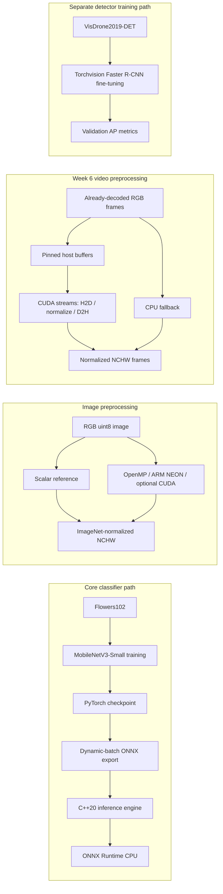

# vision-engine

Real-time aerial object detection engine, built in two layers:

1. **Core (weeks 1–3):** train a small classifier, export ONNX, run it from C++20, then quantise/prune and benchmark.
2. **Vision (weeks 4–7):** fine-tune a torchvision detector on VisDrone, add preprocessing kernels and a GPU video path.

Primary machine is a Mac M2 Air (no CUDA). GPU work runs on Colab/Kaggle; CUDA paths have tested CPU fallbacks. VisDrone is treated as **non-commercial** (licence text is inconsistent). Do not use Ultralytics YOLO.

See [AGENTS.md](AGENTS.md) for milestones and engineering rules.

## Architecture



The C++ ONNX engine runs the classifier. The VisDrone detector training and the
video preprocessing benchmark are separate paths; the benchmark does not decode
video or run detector inference.

## Current milestone: week 7 (CI, Docker, and write-up)

The Week 3 harness compares the trained baseline with globally pruned, dynamic int8, and pruned+int8 variants. It evaluates top-1 accuracy on validation images and benchmarks CPU batch-1 latency in isolated processes.

```bash
python -m optimize --config optimize/configs/flowers102.yaml
```

The command expects `outputs/flowers102_mobilenetv3_small/best.pt` from the Week 1 training run. It writes `results.md`, `results.csv`, and `raw.json` plus one state-dict artifact per variant under `bench/flowers102/`. `raw.json` records the git hash, hardware, software versions, fixed thread count, warmup, and iteration count. The reported memory is peak process RSS, measured in a fresh process for each variant.

The report includes top-1 agreement and cosine similarity against baseline logits for each variant, including int8. Dynamic int8 quantises the classifier's `Linear` layers; MobileNet's convolution layers remain float32. Pruning removes the temporary masks before saving, so pruned weights stay dense and the file may not shrink; the table reports zero-weight sparsity separately.

### Flowers102 results

Measured on the Mac M2 Air. The baseline was trained for five epochs on MPS; all four benchmark variants ran on CPU with one thread, 20 warmups, 200 timed batch-1 iterations, and 1,020 validation images. Exact metadata and values are in [raw.json](bench/flowers102/raw.json) and [results.csv](bench/flowers102/results.csv).

| Variant | Top-1 accuracy | Top-1 agreement | Cosine similarity | p50 (ms) | p99 (ms) | State dict (bytes) | Peak RSS (bytes) | Sparsity |
|---|---:|---:|---:|---:|---:|---:|---:|---:|
| Baseline | 74.22% | 100.00% | 1.000000 | 14.840 | 83.583 | 6,622,634 | 545,423,360 | 0% |
| 50% pruned | 6.08% | 6.76% | 0.805185 | 15.081 | 30.044 | 6,622,138 | 540,753,920 | 50% |
| Dynamic int8 | 74.31% | 99.51% | 0.999989 | 14.143 | 18.244 | 4,540,322 | 537,493,504 | 0% |
| 50% pruned + dynamic int8 | 6.08% | 6.67% | 0.805332 | 14.086 | 17.388 | 4,542,150 | 567,017,472 | 50% |

In this run, dynamic int8 reduced the saved state dict while retaining baseline accuracy and logits. Unstructured 50% pruning without fine-tuning severely damaged accuracy and did not reduce the dense state-dict size. The measurements are specific to this run and hardware; they are not a claim about production performance.

Set up the pinned environment and reproduce the baseline checkpoint first:

```bash
python3 -m venv .venv
source .venv/bin/activate
pip install -r requirements-dev.txt
python -m train --config train/configs/baseline.yaml
```

The full Flowers102 baseline run and Week 3 CPU comparison are complete.

## Week 2: ONNX export and C++ inference

Export the Week 1 checkpoint with a dynamic batch axis, then run the C++20 CPU engine. The ONNX file and JSON sidecar are written under `outputs/` and are ignored by git.

```bash
pip install -r requirements-dev.txt
python -m export --config export/configs/export.yaml
```

Install the pinned Python packages through `requirements-dev.txt`. The C++ build also needs the ONNX Runtime 1.31.1 CPU C++ SDK for the host platform. For Apple Silicon:

```bash
curl -L --fail https://github.com/microsoft/onnxruntime/releases/download/v1.31.1/onnxruntime-osx-arm64-1.31.1.tgz -o /tmp/onnxruntime-osx-arm64-1.31.1.tgz
mkdir -p /tmp/onnxruntime-sdk
tar -xzf /tmp/onnxruntime-osx-arm64-1.31.1.tgz --strip-components=1 -C /tmp/onnxruntime-sdk
cmake -S cpp -B build/cpp \
  -DONNXRUNTIME_ROOT=/tmp/onnxruntime-sdk \
  -DPython3_EXECUTABLE="$PWD/.venv/bin/python"
cmake --build build/cpp
ctest --test-dir build/cpp --output-on-failure
```

For AddressSanitizer and UndefinedBehaviorSanitizer, repeat the CMake build with `-DENABLE_SANITIZERS=ON`.

For Linux x86_64, use the `onnxruntime-linux-x64-1.31.1.tgz` asset in place of the macOS SDK. CMake uses installed GoogleTest 1.15.2 or fetches that exact tag. The CTest suite checks RGB preprocessing against torchvision, then checks PyTorch, Python ONNX Runtime, and the C++ executable on dynamic batch sizes 1 and 2. The parity test uses a deterministic small model and does not download Flowers102. The runtime CLI accepts caller-provided float32 NCHW buffers and writes logits to a float32 file; its preprocessing command converts RGB uint8 pixels to the same ImageNet-normalized NCHW representation as Week 1.

The C++ engine allocates reusable input and output tensors at construction for batch sizes from 1 through the configured maximum, then copies to and from those buffers on each call. CTest warms batches 1 and 2 and counts global C++ `operator new` calls across 100 inference calls. On this Mac with ONNX Runtime 1.31.1, the synthetic model currently reports 24 calls per inference across the engine and runtime. That does not satisfy the project's zero-allocation target; the counter also cannot observe allocations made through C `malloc`. Use `ctest --verbose` to see the allocation probe output.

Recheck the exported Flowers102 checkpoint against PyTorch, Python ONNX Runtime, and C++:

```bash
python -m export.parity \
  --config export/configs/export.yaml \
  --cpp-binary build/cpp/vision_engine_cli
```

On the Mac M2 Air CPU, the trained checkpoint produced these maximum absolute logit differences for seeded random float32 inputs (tolerance: `rtol=1e-4`, `atol=1e-5`):

| Batch | PyTorch vs ONNX Runtime | PyTorch vs C++ |
|---:|---:|---:|
| 1 | 3.04e-6 | 2.58e-6 |
| 2 | 2.44e-6 | 2.44e-6 |

The CTest suite also compares the C++ RGB-to-NCHW normalizer with torchvision on identical uint8 pixels. These checks validate inference and normalization parity; they do not measure C++ accuracy on the full Flowers102 validation split.

## Week 4: VisDrone detector fine-tuning

The detector is torchvision's `fasterrcnn_mobilenet_v3_large_320_fpn` initialized
with `FasterRCNN_MobileNet_V3_Large_320_FPN_Weights.COCO_V1`. Its final box
predictor is replaced with 10 VisDrone classes plus background. The dataset
loader converts the pinned Voxel51 export's normalized boxes into pixel `xyxy`
boxes, and keeps `ignore_regions` and `others` out of the loss and evaluation.
Validation reports class-averaged 101-point AP at IoU 0.50:0.05:0.95 and AP at
IoU 0.50.

Download the full train and validation splits, then train using the pinned
settings:

```bash
python -m train.download_visdrone --config train/configs/visdrone.yaml
python -m train.detector --config train/configs/visdrone.yaml --device auto
```

The downloader also supports seeded subsets. The local smoke run used 16
training images and all 548 validation images:

```bash
python -m train.download_visdrone --train-samples 16
python -m train.detector --config train/configs/visdrone_smoke.yaml --device cpu
```

That smoke run is a pipeline check, not a final detector-quality result. It
trained one epoch on 16 of 6,471 train images; its low mAP reflects this small
training sample. The committed config uses all 6,471 train and 548 validation
images for 10 epochs. Checkpoints are written periodically and can be resumed
with `--resume`. For an ephemeral Colab session, mount Drive and pass the same
Drive paths as `--data-root` and `--output-dir` on both commands, then resume
from `<output-dir>/last.pt` after reconnecting. The automatic device selection
uses CUDA when available and CPU otherwise; `--device cpu` forces the fallback.

For the full run, use [bench/visdrone/train_colab.ipynb](bench/visdrone/train_colab.ipynb).
It mounts Drive and stores the dataset, checkpoints, and live metrics there. The
configured run performs 16,180 training batches and ten full validation passes;
plan for several hours and possibly multiple Colab sessions. Exact full-run time
has not been measured. After reconnecting, rerun the setup, paths, download, and
training cells; the notebook resumes automatically from Drive's
`<output-dir>/last.pt`.
When training finishes, it copies `summary.json` as `raw.json`, plus
`metrics.jsonl` and `run.json`, to the Drive results folder. The notebook uses
Colab's Drive mount; Kaggle would need separate Drive authentication setup.

| Run | Train images | Epochs | Validation images | mAP@[.50:.95] | mAP@.50 |
|---|---:|---:|---:|---:|---:|
| Local smoke, seed 42 | 16 | 1 | 548 | 0.20% | 0.67% |

The raw run record, including per-class AP and hardware/software metadata, is [bench/visdrone/raw.json](bench/visdrone/raw.json). Local run metadata and checkpoints are also written under `outputs/visdrone2019_detector_cpu_smoke/`; datasets and model checkpoints are ignored by git. VisDrone is treated as non-commercial and share-alike because available license statements differ. The dataset mirror is [Voxel51/VisDrone2019-DET](https://huggingface.co/datasets/Voxel51/VisDrone2019-DET); cite Zhu et al., [“Detection and Tracking Meet Drones Challenge,” IEEE TPAMI (2021)](https://doi.org/10.1109/TPAMI.2021.3119563).

## Week 5: OpenMP, NEON, and CUDA preprocessing

The scalar RGB-to-NCHW normalizer is the reference. The OpenMP variant uses a
static schedule and a caller-specified thread count. ARM64 builds use NEON; other
architectures fall back to scalar. `ENABLE_CUDA` defaults to `OFF`. When enabled,
`CudaPreprocessor` allocates device buffers once and reuses them; when no CUDA
device is present or those allocations fail, it calls the scalar CPU path.

Build and run the CPU tests and benchmark on macOS or Linux:

```bash
cmake -S cpp -B build/cpp-week5 \
  -DONNXRUNTIME_ROOT=/tmp/onnxruntime-sdk \
  -DENABLE_CUDA=OFF -DENABLE_OPENMP=ON
cmake --build build/cpp-week5
ctest --test-dir build/cpp-week5 --output-on-failure
python bench/preprocess/run_benchmark.py \
  --binary build/cpp-week5/preprocess_benchmark \
  --output bench/preprocess/macos_m2.json \
  --width 640 --height 480 --warmup 20 --iterations 200 --threads 4
```

The Mac M2 Air run used Apple LLVM 21, macOS 27.2.1, a 640×480 deterministic
input, 20 warmups, and 200 timed calls. NEON output matched the scalar reference
within 1e-6. OpenMP was unavailable in this local toolchain, so its Mac row is a
scalar fallback. Colab reported 2 logical CPUs; the OpenMP row explicitly used
4 threads. The GPU was a Tesla T4 with 2,560 CUDA cores
([NVIDIA T4 specifications](https://www.nvidia.com/en-us/data-center/tesla-t4/));
the log reports GCC 13.3 and CUDA 13.0. Both runs use 640×480 RGB data and report
latency for the full call. The CUDA measurement includes host/device copies.

| Kernel | Mac M2 p50 / p99 (ms) | Mac speedup | Colab T4 p50 / p99 (ms) | T4 speedup |
|---|---:|---:|---:|---:|
| Scalar reference | 4.635 / 5.560 | 1.00× | 15.220 / 23.470 | 1.00× |
| OpenMP static, 4 threads | scalar fallback: 4.703 / 6.592 | 0.99× | 13.222 / 29.535 | 1.15× |
| NEON | 4.518 / 5.722 | 1.03× | scalar fallback: 15.176 / 23.176 | 1.00× |
| CUDA, including transfers | not built | — | 1.173 / 3.182 | 12.97× |

Hardware, compiler, git revision, warmup/iteration settings, p99.9, and parity
error are in the [Mac raw log](bench/preprocess/macos_m2.json) and [Colab T4 raw log](bench/preprocess/colab_t4.json).

## Week 6: CUDA video preprocessing pipeline

`CudaVideoPipeline` accepts contiguous, already-decoded RGB frames. Its CUDA
path allocates pinned host buffers, device buffers, and nonblocking streams once
at construction. Frames alternate across stream slots; H2D copy, normalization,
and D2H copy are queued asynchronously. The CPU fallback normalizes each frame
with the Week 5 scalar reference. Tests compare both modes against that
reference. This stage does not include video decoding or detector inference.

The Colab T4 run processed 120 deterministic 640×480 frames after 16 warmup
frames. It reported CUDA active for both variants and zero maximum absolute
error against the scalar reference. The two-stream run raised throughput by
37.6%, while per-frame end-to-end latency was higher in this run:

| Streams | Throughput (FPS) | Gain vs. 1 stream | End-to-end p50 / p99 (ms) |
|---:|---:|---:|---:|
| 1 | 860.6 | 1.00× | 1.154 / 1.245 |
| 2 | 1,184.5 | 1.38× | 1.664 / 1.874 |

Stage timings below are p50 / p99 milliseconds. CUDA transfer and kernel times
use events; FPS includes CPU input staging and output copies.

| Stage | 1 stream | 2 streams |
|---|---:|---:|
| CPU input staging | 0.111 / 0.153 | 0.108 / 0.157 |
| Host to device (H2D) | 0.084 / 0.106 | 0.086 / 0.101 |
| Normalize kernel | 0.025 / 0.029 | 0.027 / 0.030 |
| Device to host (D2H) | 0.286 / 0.306 | 0.286 / 0.305 |
| CPU output copy | 0.623 / 0.688 | 0.677 / 0.764 |

The runtime reported Linux x86_64, 2 logical CPUs, GCC 13.3, CUDA 13.0, and a
Tesla T4. The [raw Week 6 result](bench/video/week6_t4.json) includes p99.9,
driver details, exact metadata, and the source commit. The measurement covers
synthetic already-decoded frames, not video decoding or detector inference.

## Week 7: CPU CI and Docker

The GitHub Actions workflow runs on Ubuntu 24.04 for pushes and pull requests.
It installs CPU-only PyTorch, runs pytest and Python format checks, downloads the
pinned ONNX Runtime 1.31.1 C++ SDK, then builds and runs CTest with ASan and UBSan.
CUDA is disabled. A dependent job builds the CPU Docker image and smoke-tests
the CLI preprocessing command.

Build the image locally and preprocess a raw RGB frame (the input file must hold
exactly `width × height × 3` bytes):

```bash
docker build --file docker/Dockerfile --tag vision-engine:cpu .
mkdir -p outputs
docker run --rm \
  --volume "$PWD/inputs:/inputs:ro" \
  --volume "$PWD/outputs:/outputs" \
  vision-engine:cpu \
  preprocess 640 480 /inputs/frame.rgb /outputs/frame.nchw.f32
```

The image contains the C++ CLI, preprocessing benchmark, and ONNX Runtime shared
library. It does not contain model weights or datasets; mount those as needed.
The Docker build is CPU-only and does not install a CUDA toolkit.

## Limitations

- The C++ ONNX path demonstrates classifier inference. The VisDrone Faster R-CNN
  is trained and evaluated in Python and is not integrated into the C++ engine
  or Week 6 video pipeline.
- The reported detector result is a one-epoch smoke run on 16 training images,
  not a full-data VisDrone model-quality result. VisDrone is treated as
  non-commercial because the available license statements conflict.
- Week 6 uses synthetic, already-decoded frames on one Colab T4. Two streams
  improved measured throughput, while the measured per-frame end-to-end p99 was
  higher than with one stream. These results do not include decoding, detector
  inference, or camera I/O and are not production-kernel comparisons.
- The ONNX Runtime allocation probe currently counts 24 C++ `operator new`
  calls per inference on the recorded Mac run. This misses C `malloc` calls and
  does not meet the project's zero-allocation goal.
- Unstructured pruning without fine-tuning sharply reduced classifier accuracy
  and did not shrink the dense state dict in the measured run. Dynamic int8
  retained accuracy for that checkpoint and hardware.
- CI and Docker exercise CPU paths only. CUDA compilation and performance are
  validated separately in Colab; the local Mac cannot compile or run CUDA.

Tests (synthetic tensors; no Flowers102 download):

```bash
pytest
ruff check train export optimize tests \
  bench/preprocess/run_benchmark.py bench/video/run_video_benchmark.py
black --check train export optimize tests \
  bench/preprocess/run_benchmark.py bench/video/run_video_benchmark.py
```

## Status

Weeks 1–3 are complete with the recorded Flowers102 training, ONNX/C++ parity, and optimization table. Week 4's resumable VisDrone pipeline is implemented; its reported local smoke run used 16 training images, and full-data training remains for Colab/Kaggle. Week 5's OpenMP, NEON, and CUDA parity and preprocessing measurements are recorded in the CPU and T4 logs. Week 6's stream and pinned-memory pipeline and Colab T4 throughput/stage measurements are recorded above. Week 7 adds Ubuntu CPU CI, sanitizer checks, and a CPU Docker image; the GitHub Actions result must be confirmed after this change is pushed.
